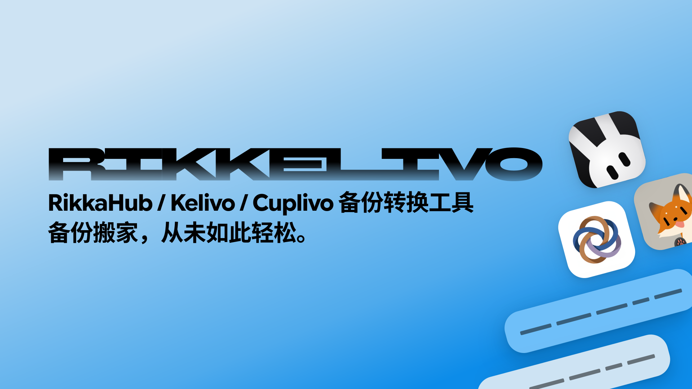

# Rikkelivo

[](https://github.com/DeepslateQAQ/rikkelivo/actions/workflows/nuitka-build.yml)

在 RikkaHub、Kelivo 和 Cuplivo 之间搬家。

把任意一家的聊天备份丢进来，选好目标应用，就能拿到另一家可以直接恢复的归档。消息、设置、模型、记忆和附件会尽量原样带过去；目标格式装不下的部分，会在转换结束时逐类列清楚。

- 三应用互转，也支持同应用内的格式升级和降级
- 直接读写原生 SQLite 和归档，不经过中间 JSON
- 输入自动识别并校验，输出原子发布
- 有损内容分类报告，每一项降级都看得见

## 下载

GitHub Actions 用 Nuitka 构建单文件二进制。下面的 [Nightly.link](https://nightly.link/) 链接指向 `master` 最新一次成功构建。Linux / macOS 解压后先执行 `chmod +x rikkelivo`，Windows 直接运行 `rikkelivo.exe`：

| 平台 | 产物 | 下载 |
| --- | --- | --- |
| Linux x86_64 | `rikkelivo-nuitka-linux-amd64.zip` | [Nightly.link](https://nightly.link/DeepslateQAQ/rikkelivo/workflows/nuitka-build/master/rikkelivo-nuitka-linux-amd64.zip) |
| Linux arm64 | `rikkelivo-nuitka-linux-arm64.zip` | [Nightly.link](https://nightly.link/DeepslateQAQ/rikkelivo/workflows/nuitka-build/master/rikkelivo-nuitka-linux-arm64.zip) |
| Windows x86_64 | `rikkelivo-nuitka-windows-amd64.zip` | [Nightly.link](https://nightly.link/DeepslateQAQ/rikkelivo/workflows/nuitka-build/master/rikkelivo-nuitka-windows-amd64.zip) |
| macOS Intel | `rikkelivo-nuitka-darwin-amd64.zip` | [Nightly.link](https://nightly.link/DeepslateQAQ/rikkelivo/workflows/nuitka-build/master/rikkelivo-nuitka-darwin-amd64.zip) |
| macOS Apple Silicon | `rikkelivo-nuitka-darwin-arm64.zip` | [Nightly.link](https://nightly.link/DeepslateQAQ/rikkelivo/workflows/nuitka-build/master/rikkelivo-nuitka-darwin-arm64.zip) |

Windows 压缩包里是 `rikkelivo.exe`，Linux / macOS 里是 `rikkelivo`。想挑某一次具体构建，可以直接去 [Actions](https://github.com/DeepslateQAQ/rikkelivo/actions/workflows/nuitka-build.yml) 页面。

## 支持的格式

### 输入

- **RikkaHub**：Room 24–31 的 `rikka_hub.db`、`settings.json` 和附件
- **Kelivo / Cuplivo 原生归档**：archive 2/3 + SQLite schema 1–3，包含 `manifest.json`、`settings.json` 和 `database/kelivo.db`
- **Kelivo `chats.json` v1**、**Cuplivo `chats.json` v2**
- **Cuplivo JSONL v2**：`conversations.jsonl`、`messages.jsonl`、`chats_meta.json`
- **仅设置备份**：只有设置、没有数据库时，迁移目标能表达的那部分

输入由命令行参数指定，全程离线，源文件保持只读。

### 输出

默认写出目标应用当前稳定的格式；需要兼容旧版本时加 `--legacy`。

| `--to` | 默认输出 | `--legacy` |
| --- | --- | --- |
| `rikkahub` | RikkaHub 3.1.0（Room 31） | Room 24（2.4.11 / 2.5.0 基线） |
| `kelivo` | Kelivo 1.3.1+（archive 3 + SQLite 3） | Kelivo `chats.json` v1 |
| `cuplivo` | Cuplivo 4.3.0+（archive 3 + SQLite 3） | Cuplivo `chats.json` v2 |

Kelivo 和 Cuplivo 的最新版已经不再读取 JSON v2，所以 `--to cuplivo --legacy` 是给旧版 Cuplivo 用的。

## 用法

```bash
# 在源码目录里运行
uv run rikkelivo backup.zip --to kelivo
uv run rikkelivo backup.zip --to rikkahub --legacy -o out.zip
uv run rikkelivo backup.zip --to cuplivo --force

# 或者直接用下载的单文件（Windows 下跳过 chmod，运行 .\rikkelivo.exe）
chmod +x rikkelivo
./rikkelivo backup.zip --to kelivo

# 只给输入路径，进入交互向导
uv run rikkelivo backup.zip
```

默认输出放在源文件旁边：`<源名>.<目标>.zip`；加 `--legacy` 时是 `<源名>.<目标>.legacy.zip`。`-o/--output` 写相对路径时，以当前目录为准。

目标文件已存在时，参数模式需要加 `--force`；向导会再问一次覆盖确认。输入文件名和命令撞名时，用 `--` 或 `./` 区分：

```bash
rikkelivo -- to-kelivo --to kelivo
```

`to-rikkahub` / `to-kelivo` 还能用，但已经隐藏并标记为弃用，stderr 会提示新写法。

在终端里直接运行时，会进入交互向导（stdin / stdout 都是 TTY，且 `TERM` 不是 `dumb`）。向导会显示检测结果、让你选目标和格式、输入路径，然后列出所有降级和丢弃内容，最后请你确认。两个确认默认都是 No；只有最终确认后才会发布输出，Ctrl-C、EOF 或取消会以 `130` 退出。

## 转换时会发生什么

成功摘要写到 stdout，数据损失、降级和弃用提示写到 stderr。有损转换仍然退出 `0`；无法识别、文件损坏或写入失败退出 `1`；参数错误退出 `2`。

输出先写到同目录的临时文件，完整校验通过后才原子发布；同名文件存在时，只有 `--force` 会覆盖。源文件保持只读，symlink / hardlink 别名同样只读。

目标格式没有对应位置的内容会按类别计数并报告，例如独立媒体创作库、独立翻译历史、独立用量流水、favorite / folder、Cuplivo 群聊控制。工作区只迁移元数据；目录内容、rootfs、shell 和工具授权需要在新环境里重新配置。记忆按目标应用的权限模型投影：RikkaHub 的共享记忆只写入原本启用共享的助手，Kelivo 的全局 / 私有 / archived 条目按目标能力落位。

消息搜索索引每次都会重建。当前 Python 的 SQLite 缺少 RikkaHub 的 `simple` 分词器时，会使用 `unicode61`，并在报告里标记 `search_tokenizer_changed`；普通实体表和 WAL 数据仍然完整读取。归档的 `manifest.json` 会把 `appVersion` 写成 `rikkelivo/<版本>`，一眼能看出这是转换产物。

## 安装

需要 Python 3.10+ 和 [uv](https://docs.astral.sh/uv/)。

```bash
uv sync --group dev                # 开发和测试
uv sync --group dev --group build  # 额外安装 Nuitka，用于构建单文件版
```

## 测试

```bash
uv run pytest
```

测试数据由仓库内的 fixture 生成，不需要真实用户备份。

## 构建单文件版

GitHub Actions 会在每次 push 和手动触发时构建五个平台的产物，跑 `--help` / `--version` 冒烟检查后上传，配置见 `.github/workflows/nuitka-build.yml`。

本地构建：

```bash
uv sync --all-groups
scripts/build.sh       # Linux / macOS → build/linux|macos/rikkelivo
scripts/build.ps1      # Windows → build\win\rikkelivo.exe
```

Linux 需要 `patchelf`，Windows 需要 MSVC（Visual Studio Build Tools），macOS 开箱即用。单文件产物已经包含 Questionary、prompt_toolkit、wcwidth 和 `rikkelivo/schemas`，目标机器不需要安装 Python。

需要更宽的 glibc 兼容面，或者在 NixOS 这类发行版上构建时，可以用容器：

```bash
scripts/build-in-container.sh              # ubuntu:22.04 (glibc 2.35) → dist/rikkelivo
scripts/build-in-container.sh --cleanup    # 构建完删除复用的容器
```

## 格式来源

`src/rikkelivo/schemas/` 里是固定上游提交导出的 Room / Drift schema，运行时读取。具体来源、提交与许可说明见 [`src/rikkelivo/schemas/README.md`](src/rikkelivo/schemas/README.md)。
